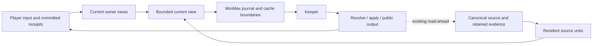

# Continuous Keeper context: residency prototype

Status: stages 2-7 scoped implementation and validation complete and retained, 2026-10-17. Stage 6's t216 native feedback follow-up retains its interrupted integration run and successful isolated rerun. Stage 7's t230 receipt-conditional feedback follow-up is frozen with 21 native checks and completed LAN validation through explicit phase reuse and test-only corrections. Genuine natural continuation succeeds; successful natural recovery through the corrected refusal branch remains unproven. Do not attribute earlier checks to a later source. The earlier residency experiment remains isolated.

Latest stage 4 result: the final same-Keeper path reuses destination material already read for Jev. Two genuine MiniMax-M3.1-Flash-Preview/medium inputs from the same retained library position took 14.644 s and 23.795 s versus the retained control's 27.181 s and 43.609 s. Main requests were 1+2 versus 1+3; the movement input used one apply instead of lookup plus apply. Actual provider payload counters confirm that prepared material survived projection. All observed auxiliary starts also used MiniMax/medium. This is two inputs in another scene, not a replay of t184 or a stable speedup estimate. The earlier candidate with only batching/protocol repair took 14.059 s and 31.825 s but retained 1+3 requests; it is preserved separately.

Latest result: the corrected all-role MiniMax/medium, same-seed two-input comparison took 64.178 s for the same-Keeper path versus 80.005 s for explicit isolation. Independent author tasks fell from two to zero, but main requests rose from three to four because both direct replies initially omitted their public marker. Neither arm read material. This small natural sample shows lower elapsed time and fewer author handoffs, not stable latency or elimination of format corrections. A late cash-authority producer gap is also repaired and separately validated below; that patch postdates the A/B runtime. Stage 2 residency did not establish a speedup.

## Intent and acceptance

### Stage 8: stable submitted context and nonblocking optional preparation (owner approved)

The owner authorized optimizing the seven-input MiniMax diagnosis and moving optional work off the foreground. Baseline evidence is `.coc/experiments/continuous-reuse-20261017/`: seven genuine inputs, 11 main requests, 22 short-lane requests and 63 tool-enabled author requests, with overlapping background work counted separately from 153.661 seconds of accumulated player waiting. Preserve this trajectory and the v6 runtime. Current branch is 0.9.8a; unrelated dirty work remains owned by its original writers. No App packaging, model/default changes, new judge, automatic effect application, dependency installation or campaign cleanup is included.

- [x] Contract and native regressions: material screening consumes the fresh projection before the request journal. No later screen rewrites submitted snapshots. Optional Jev selection starts once per input in the background; a missing, late, stale or unavailable answer retains the source. A ready exact-basis answer may affect a later projection through the ordinary journal revision, never by rewriting the prior prefix.
- [x] Reuse only verified snapshot-bound historical original reads. Keep current transcript listings, fresh world/NPC state and source changes authoritative; cache no semantic search, latest-state answer or failed/incomplete result. Bound memory and clear session ownership.
- [x] Keep typed voice review in Jev. Uncertainty remains unpublished, with the generated candidate retained under its exact source identity for a bounded later review. Do not invoke another LLM judge or regenerate the same candidate solely because the review was uncertain. Actual rejection retains the existing one-repair route.
- [x] Clarify the existing same-Keeper record route for fully known NPC reunion updates and explicitly unregistered equipment. These are model proposals through the existing transaction, not host-invented actions or automatic splits.
- [x] Audit foreground/background ownership. Keep action admission, dice/state arithmetic, required source reads, transactions and publication dependencies foreground. Existing memory/journal/first-sight/voice/preview queues remain background; measure their failures and calls rather than treating async work as free.
- [ ] Run focused native and selected LAN tests, then genuine MiniMax M3.1/medium movement and NPC dialogue from the retained CoW seed. Record actual final payload prefixes, main/auxiliary request attempts, foreground latency, refusals, state receipts, storage and remaining limitations. No single-trajectory stable speedup claim.

External cross-check: MiniMax's explicit cache contract requires unchanged prefix content; Unity Addressables separates asynchronous asset preparation from use after completion. TypeSafe's documented confidence routing leaves control and uncertain decisions to application policy. These support stable publication boundaries and conservative pending material, not semantic permission or a guaranteed latency improvement. URLs: https://platform.minimax.io/docs/api-reference/anthropic-api-compatible-cache ; https://docs.unity3d.com/Packages/com.unity.addressables@1.21/manual/load-assets-asynchronous.html ; https://docs.typesafe.ai/patterns/confidence-routing .

Stage 8 measured evidence: `.coc/experiments/foreground-optimization-20261017/result.json`, with raw play in `.coc/playtests/foreground-opt-minimax-20261017/`. The frozen runtime matches eight owned sources in seven compiled entries (13 embedded occurrences); it also preserves unrelated current-tree changes, so it is not a code-isolated A/B. Local targeted checks pass 80/80, transaction/admission checks 20/20, fast smoke 130/130 and kernel typecheck exits zero. The first fast smoke failed on the renamed material-screen inventory site; the synchronized inventory and rerun are retained separately. LAN build exits zero; broad focused LAN validation remains running.

Seven genuine MiniMax M3.1/medium inputs took 15.141, 12.778, 16.446, 14.537, 13.959, 16.919 and 27.007 seconds (116.787 total), versus the earlier natural trajectory's 153.661 seconds. Main calls were 10 versus 11; verified-history RPCs 60 versus 108 with 36 exact original-cache hits. Eight of nine outgoing full-message prefix comparisons preserve the entire previous request; the sole exception is an explicit capacity checkpoint. Material selection has seven background decisions and synchronous projections; short one-response turns retain full optional source, so this does not prove effective retirement or smaller requests. Fifteen short-lane requests and 27 tool-author requests overlap play/startup; zero are generative voice reviews. These counts are not serial foreground steps or a controlled savings estimate: this trajectory did not create the earlier notebook document/presentation work.

Live limitations are part of acceptance: input 3 describes note-taking but carries no document write, so the equipment clarification is not live-validated. Input 6 move admission is low-confidence; input 7 final-record admission is again low-confidence (0.52) and requires a second Keeper request. No arrival receipt exists, despite public prose placing the player at the library. This is an existing settlement/admission seam requiring separate diagnosis; it is not successful movement recovery, a format retry or a speedup on the same work. Reunion-record adoption remains unproven. Typed voice uncertainty leaves optional cards unpublished after the existing bounded allowance. The driver is stopped and evidence retained; managed live growth is 8.8 MB. No App package or global model change was made.

### Stage 7: inline KernelError correction keeps the same response rule and existing receipts (t230)

The original t230 audit confirms a valid first record, positive consent, then a real kernel invalid_params/book_name refusal. Concrete correction feedback was visible; missing feedback is not established. That correction also forbade another record and mandated public prose, conflicting with the existing supported correction frame. Only this native prefix is changed to use the shared same-Keeper post-result rule while retaining original error code/fix/details. Because the catch also covers later publication errors, final wording leaves only unreceipted proposals unsettled and preserves every receipt-confirmed effect/event. No NPC name or time is automatically corrected/replayed. The internal inline/dispatcher finalization difference remains unchanged; it is not attributed as the cause of one failure. Contract: kernel-rpc 237.12.5.

- [x] Native Pi/TS checks pass 21/21: a true book_name kernel refusal suppresses its candidate body; the same Keeper explicitly corrects the record and commits once before public bytes; a stay-here control writes nothing; an earlier successful minute remains recorded when the later inline batch fails. Correcting the NPC changes the whole proposal key and preserves fresh existing Jev consent review; the successful correction still uses two main responses and no second author. Fast checks pass 130/130 and kernel typecheck exits 0.
- [x] Preserve preliminary v6 and all earlier failed fixture diagnostics separately. Final receipt-boundary source/entries are in `handoff-v6-final-pending.json` and `source-parity-v6-final.json`: 17 owned sources, six entries, 29 embedded occurrences; only the kernel extension differs from v5.
- [x] Complete the new dependency-selected LAN validation through explicit phase reuse. The initial run retains extension exit 1 (3,747 passed, two failed), native integration exit 0 (2,212 passed, one skipped), and routing exit 0 (12 passed). Test-only corrections retain all behavior assertions: update the obsolete exact feedback wording, await the actual outage status after asynchronous telemetry persistence, and register worker exit listeners before awaiting messages. Local extension checks pass 58/58. The new 423-file extension run passes 3,748/3,749; its sole failure is the migration manifest retaining the repaired driver's old counterpart file hash. The repaired driver then passes 11/11 on LAN. Update only its 11 current counterpart SHA fields, preserving all frozen originals, assertion inventory and historical validation; the full manifest guard plus both mandatory smoke files then pass 19/19 on LAN. All selected assertions are validated across these phases, with the same 17 frozen production hashes. This is not a single clean full rerun. Preserve both original exit-1 reports and the exact phase mapping in `handoff-v6.json`. The one native skip is the missing retained baseline telemetry fixture. No product budget or assertion is removed.
- [x] Inspect the original browser's natural MiniMax/medium t231 continuation: two actual main requests and no inline failure; one time195 receipt advances 08:45 to noon, with NPC/event/variation receipts. The owner reports 56 UI seconds. `readonly-t231-v6-live-verification.json` reads a bounded native window covering the entire turn, confirming no failed-inline correction occurred. This is genuine natural successful settlement, not a replay of t230, retroactive repair or live coverage of the corrected refusal branch.

### Stage 6: native feedback preserves the independent selected record route (t216)

The original browser t216 refused move/NPC/event as one atomic batch, then public-only prose asserted an unrecorded signature. The event was not independently admitted by consentOnly; legacy admitted-line credentials cannot be reused for it. The existing event-only final record already supports this operation without another author or consent judgement. Read-only diagnosis and the unapplied candidate are retained in t184's `t216-readonly-recovery-design.json`; the original t216 stays unchanged, and the browser's later t217 signed-copy transaction is its own new successful occurrence.

The scoped implementation aligns native post-result feedback: the existing shared response owner distinguishes public-only settled conversation from a remaining known record/text response; the native apply description uses that rule; native unavailable/not-authorized feedback explicitly leaves the whole failed event/effects unsettled and permits only a genuinely independent selected remainder. Legacy wording remains the default, and isolated expression behavior is unchanged. No semantic splitter, automatic apply, threshold/budget change, new judgement, first-refusal stop or prose-state detector is added. Contract: kernel-rpc 237.12.4.

- [x] Native controlled Pi/TS regression inspects actual next-request feedback and tool descriptions. One refused mixed proposal followed by the same Keeper's independent event/text record yields one event receipt before the first public delta, no move/NPC/time receipts, two main responses and one consent decision. The control chooses public-only conversation and records no event, proving there is no automatic event application.
- [x] Focused native checks pass 32/32, feedback/legacy/language checks 43/43, beside compatibility 5/5, fast checks 130/130, and kernel typecheck exits 0. V5 freezes six entries, 17 source files and 29 embedded occurrences. Kernel, table and hybrid entries change; the other three stay byte-identical to v4. `handoff-v5-pending.json` retains exact mappings.
- [x] Execute the dependency-selected LAN regression: 430 extension files pass 3,799/3,799; integration records 2,211 passed, one skipped and one interrupted failure; routing passes 12/12. The unchanged driver-process test hung because exit listeners are installed after worker messages; a minimal reproduction times out with exited workers and succeeds with early listeners. Only this owned hung test worker was terminated. The same unmodified file reruns 11/11 under a 60000 ms timeout. Preserve the original exit 1 in `selector-result-v5-initial-counts.json`; do not present it as a green full run or edit the test to conceal it. This validation interruption is independent of the native protocol change.
- [x] Genuine all-role MiniMax/medium continuation is retained in `live-v5-result.json`: 14.558 seconds, one main request and six observed medium auxiliary starts. No refusal occurred; the visitor-log signature appeared in public prose with zero receipts. This is not recovery-branch acceptance or evidence of successful formal signature settlement. An incidental visitor log is not automatically equivalent to the formal witness-statement commitment in t216. Prompt alignment cannot guarantee every future plain-prose assertion matches state; no broader semantic guard was added to improve this sample.

### Stage 5: a spent zero-settlement write budget cannot author success (t206)

The independent browser owner loaded the stable stage 4 source in the original Blood Road game. T203 reused prepared material and delivered in 48.019 s, with one corrected final-frame syntax error. T206 subsequently took about 232 s and 13 main requests; three distinct recalls totaled 55.644 s, three applies were actually not_authorized and a fourth reached the class-limit block. The same Keeper had the explicit refusals but still narrated departure/arrival at an advanced time with zero receipts and unchanged clinic/clock. Different query strings and selected evidence occurrences mean repeated identical retrieval is not established. Different proposed destination labels/handles with no establishment mean a false-positive permission judgement is not established. Preserve `readonly-t206-read-latency-and-ghost-move.json` in the original GUI evidence root; do not rewrite its ghost public record or canonical state.

The scoped repair uses the existing endInput/unfinished-notice/stranded-release path when the native current player turn exhausts an apply/resolve refusal class and a fresh expected-turn receipts projection confirms zero settlement. It ends before another inference/publication; it does not add a semantic judge, lower thresholds, auto-move, choose another place or restore old memory by fiat. Receipt-bearing partial results and ordinary correction before exhaustion retain the existing route. This is a consistency stop, not proof of successful player-goal completion or faster meaningful play. Full wording and the boundary tradeoff are in kernel-rpc §237.12.3.

- [x] Compare the recorded error-feedback seam with primary MCP/Anthropic practice, including application-controlled stopping; visible errors do not enforce model obedience.
- [x] Capture actual t206 write arguments and accepted public body without reasoning in the bounded native regression fixture. The old source requests the fourth false-arrival answer (4 versus 3); the repaired source stops after three refusals, exposes no prose, preserves the original input/clock/receipts, durably reaches awaiting_player and accepts the next genuine input at that same native seam.
- [x] Preserve a valid partial settlement: one accepted minute remains recorded and can be narrated after later failed writes. Core native/correction/runaway tests pass 12/12; the fast tier passes 130/130. This controlled replay is not live gameplay evidence.
- [x] Freeze six v3 entries and all 25 embedded occurrences of 16 owned sources under candidate-v3; retain that revision separately. Its full LAN extension selection found one real regression: aborting within tool-result finalization inserted a synthetic cancellation result before the original third refusal. The retained diagnostic reproduces the duplicate, rather than treating it as a changed assertion. The v3 native integration and routing phases pass.
- [x] Fix that ordering through endInput's explicit settled_operation boundary: latch the existing marker/runCut, return the original tool result, then let the existing native policy finish before any next inference. All other callers keep immediate abort. Freeze six v4 entries and the same 25 owned-source occurrences under candidate-v4. Native identity/exhaustion/correction/release tests pass 16/16, additional refusal/language checks pass 30/30, fast checks pass 130/130, and kernel typecheck exits 0. Each of the three refused calls must have one original error result, and there must be no fourth model request.
- [x] Complete the v4 dependency-selected LAN regression: 441 extension files yield 3,843 passed, zero failed and eight reflink-filesystem skips; 175 native integration files yield 2,212 passed, zero failed and one missing retained-baseline telemetry skip; routing passes 12/12. Every phase exits 0. `selector-result-v4.json` retains exact counts, skips, source hashes and remote evidence paths. Preserve v2's green and v3's failed extension results separately. A final audit verifies all 16 owned sources, six frozen entries and 25 embedded source occurrences unchanged.
- [x] Genuine MiniMax/medium continuations are retained with explicit limits. The independent original browser T207 clarified the destination in 26 seconds with one main request, unchanged clinic/clock and zero receipts; it did not trigger exhaustion. The private final-v4 driver sample from the retained library seed takes 12.624 seconds/one main request and 29.952 seconds/three main requests, with zero tool errors. The movement reply uses one scene/NPC lookup batch before apply, so elimination of retrieval is not universal. This second input follows its actual first reply and is not an exact matched A/B input. Actual main wire and all six observed auxiliary starts are MiniMax/medium. `live-v4-result.json` records growth of 3,988,074 bytes within the existing storage limits. A second managed original-game seed attempt was refused because its source reader still held a selected module file; do not stop or copy the active original to manufacture a seed.

The deterministic guarantee is the verified zero-settlement exhaustion branch. It does not semantically verify arbitrary earlier drafts or every receipt-bearing partial response. Ordinary clarification remains natural prose/free input; the current ask tool is mechanics-only. Global/App defaults and model profiles are unchanged.

### Stage 4: t184 measured round-trip reduction (owner approved, 2026-10-17)

The owner explicitly requested a step-by-step explanation of the genuine t184 124-second/17-step turn, further scoped repairs, and MiniMax retesting. Preserve the original browser campaign and all earlier evidence. Work remains on 0.9.8a with concurrent dirty files preserved; no App packaging or global model/profile changes. Use the existing native driver for any independent live comparison, with MiniMax-M3.1-Flash-Preview/medium for every generative role, one natural player input at a time and managed CoW seeds.

Evidence root: `.coc/experiments/t184-latency-20261017T101338/`. Its source-linked trace contains 17 nonterminal driver steps plus a terminal finish: eight inference steps total 80.560 s, operations total 29.646 s, including two recall batches totaling 24.622 s. Actual main-provider calls total 62.792 s; another 16.666 s precedes those provider calls and 1.102 s follows them inside the inference steps. Repeated capsule/person/mod reads and overlapping UI work are visible there, but their summed RPC duration is not exclusive wall time. Initial continuous preparation reports packing_limit. Two tool attempts fail on missing event material visibility and missing movement via. Four module queries miss; one short NPC-name query succeeds. The UI's 124 s, canonical open/close span and driver-step intervals are different clocks and must not be summed.

Ready work: complete the 17-step table and identify repeated reads; reproduce confirmed producer/reader/actor defects at their real seam; cross-check substantial candidate repairs against primary practice; amend the kernel contract before code; run scoped native regressions and the appropriate LAN checks; then run genuine MiniMax/medium play and report requests, preparation, semantic checks, corrections, first-public/full-delivery timing and quality separately. A smaller packet or mock-only speed result does not establish live improvement. Keep current consent thresholds, numeric rules, atomic writes, private-public boundaries and source authority intact. Existing typed decisions may batch independent work, but no semantic regex routing or automatic removal of player constraints is allowed.

Implementation and evidence:
- [x] Retain `t184-trace.json`, `step-breakdown.md` and `infer-overhead.json` without source reasoning text.
- [x] Batch independent canonical original windows in groups of at most eight, charging one action per window; cache only immutable commit/turn blobs within the existing evidence snapshot. A real kernel regression verifies complete original proofs and three occurrences sharing two Git blob reads. Original scope, stale-finish and scalar compatibility remain covered.
- [x] Split independent continuous Jev candidate groups at actual packing bounds within the same shared token/cost/deadline lease; defer oversized source conditions explicitly and withhold automatic movement when destination coverage is incomplete.
- [x] Preserve the existing destination view in candidates and return relevant prepared option material to the same Keeper, with input/world/source invalidation and a 24 KiB bound. Native projection and actual MiniMax payload observations verify the producer/reader seam; the genuine move reuses the supplied place and settles its 30 minutes.
- [x] Issue the existing query, explicit visibility and movement-route requirements before calls, preserving deterministic refusals and ordinary NPC inference.
- [x] Run real same-seed MiniMax control, initial candidate and final candidate, then stop only these private drivers. The original browser seed capture was refused because a reader still had its module scope open; preserve that original campaign and use the retained quiescent library position. `comparison.json` records capacities, exact timing/model evidence and this comparability limit.
- [x] Fast suite 130/130, kernel typecheck, final targeted LAN Node seams 139/139 and targeted memory/recall/worldline integration 59/59 pass. The earlier full extension snapshot ran 5,870 tests: 5,859 pass, two failures and nine skips. Both failures were scalar-only test doubles; migrate their protocol without changing budgets, ready assertions, original evidence or private refs. Local reproductions now pass.
- [x] The final 449-file extension selection passes 3,903 tests with eight reflink-platform skips; 175 native integration files pass 2,212 tests with one missing retained-baseline skip; routing passes 12/12. Every phase exits zero. Preserve the earlier full-snapshot failures and all nine final skip reasons in selector-skips.txt; selector-result.json records actual phase exits.

Current final source/build correspondence is `source-parity-v2.json`: six loadable entries, 16 task-owned source files and all 25 embedded occurrences matched. The final source is stable; this task does not package or change App defaults. `working-handoff.json` tracks validation until the final handoff can be issued.

### Stage 3: continuous decisions and protocol repair (owner approved, 2026-10-17)

The owner authorized production repair and testing after the stage 2 diagnosis. The success criterion is fewer generative planning/handoff requests for the same playable action, with existing kernel authority intact. Source is 0.9.8a at 42f912401 plus preserved concurrent dirty work. The other active setup/App task is preserving its own evidence; its package and campaign paths are outside this task.

Approved scope: the current RunDriver, bounded Jev choices over host-issued options, Jev-only action admission, the existing same-Keeper publication path, and the reproduced event/document/definition recovery contracts. Keep existing tools, rule arithmetic, transactions, cognition, receipts and cancellation. Do not restore the old NPC-first controller, introduce a second world store, change model credentials or package the App.

Ready work:
- [x] Add the production contract before implementation and retain a red regression for each repaired seam.
- [x] Drive fully bound ordinary actions with one batched Jev decision; keep unknown/open actions with the same Keeper and prevent repeated routing of unchanged state.
- [x] Use Jev rather than a generative reviewer for affected action admission, with same-input/proposal reuse and no write on unavailable or uncertain authorization.
- [x] Default ordinary play to the existing same-Keeper writer. Permit the existing private-record/public-text transport for bounded deterministic changes, committing before exposure; preserve tool continuations for genuinely unknown results.
- [x] Distinguish revealed-but-unavailable handouts from hidden ones and supply actionable event/carrier/definition recovery.
- [x] Run native regressions and focused LAN checks, then genuine MiniMax-M3.1-Flash-Preview/medium play through the real driver.
- [x] Repair the late typed cash-limit producer/consumer gap, validate exact-amount and bound-quotation authority without weakening numeric checks, and freeze loadable entries separately from the earlier A/B runtime.

Validation: reuse the retained seed through the managed driver; bound each new run to 512 MiB growth and 10 GiB free space. Record actual main/auxiliary models, Jev families/calls, main requests, failed tools, first public text and full delivery time. Retained trajectories support component comparisons only; natural play must not be replaced by replay or fabricated turns. Existing evidence is never deleted. The LAN probe selected idle leehow-pc; heavy build/tests belong there, live play remains on the Mac.

Implementation checkpoint: the four protocol regressions first failed and now pass. Native decision-port tests cover selected-once execution, low confidence and stale-world refusal; typed admission tests prove one Jev batch and no generative review; the real Pi/native event-publication seam commits NPC speech and knowledge with one Keeper request. Fast lane is 130/130, system-language guards 5/5, and the project kernel typecheck passes. An initial 63-case selection passed 62 and exposed cross-lane activation caused by treating any Jev key as admission configuration. The new explicit RunDriver decision port fixes that coupling; its original rollback regression passes unchanged. Do not claim the whole 63-case selection green until the final LAN run.

The first LAN focused run captured an earlier source snapshot and was stopped through its verified remote signal trap after the decision-port repair; keep its logs and source evidence. A fresh build/final focused run is still required. The initial build-fetch succeeded (run.9MDPMt2R), but its host bundles predate the port repair and must not be used as current live evidence. An exploratory host-wide tsc invocation is not a project validation gate and encounters existing retired-controller/dependency declaration failures; kernel typecheck and actual native seams remain separate.

Live preparation explicitly reads the existing App Jev vault into child environment through the retained read-only vault helper, without printing or writing its value. Parent CLI environment has no Jev key. The preparation helper verifies embedded build/source parity, uses forced CoW and pins all generative roles to MiniMax/medium; do not rely on the older driver's Luna default.

Final targeted checkpoint: 15 native/typed-routing/system-language tests and five protocol/readiness tests pass. Native publication verifies one Keeper request plus one typed batch for NPC speech and heard knowledge; an unchanged uncertain record receives one typed batch across correction and exposes no dependent prose. Canonical dispatch now forwards the actual AgentSession, covered by a regression that first failed without it. Handout receipts distinguish copyable text/image from revelation and display availability.

The preliminary real MiniMax opening is retained in `context-residency-stage3-single-20261017T064458`; its driver is stopped. Its quiescent post-opening state is the common retained seed at `.coc/experiments/context-residency-stage3-20261017T064458/seed` (180 dependency-selected files, 7,054,752 bytes). Final runtime `.coc/experiments/context-residency-stage3-final-20261017T065851` verifies all 11 source/build entries, with 157,683,752,960 bytes free at admission. It supersedes the preliminary runtime for player-input evidence. Candidate and explicit-isolation control start from this same actual opening; neither arm has fabricated state or a scripted player.

Further real failures and correction: `context-residency-stage3-final-single-20261017T065851` delivered its first NPC answer in 15.071 s with one main request and no author; its acquisition input then needed five tool attempts and 53.8 s because the new integration incorrectly used the retained v1 comparison family. The role-first retry `context-residency-stage3-roles-single-20261017T070439` still over-reviewed atomic event/NPC facts, taking nine tool calls and 75.6 s for acquisition. Both are stopped, preserved failures rather than acceptance. Recorded Jev-only component probes include all earlier question designs, their probabilities and the ambiguous cases; they perform no gameplay writes.

The corrected boundary reviews only voluntary effects, with `consentOnly` excluding NPC disclosure/event truth and preserving the whole transaction and its source/delivery checks. One independent Noul per affected line is batched through the current driver port; no new adapter/reviewer owner is created. Keeper-proposed effects use the documented 0.6/0.4 deadband; autonomous host execution retains 0.9. In the diagnostic bank seven unchosen/limited cases are never admitted; one generic bilingual move remains uncertain, and a deliberately direct NPC-consent call is outside the production path (the native test proves that path invokes no such review). These are limitations, not an accuracy or natural-play claim. Final targeted checks now pass 17/17 plus the five protocol cases; fast lane is again 130/130 after removing the unnecessary new adapter constructor caught by the control-flow inventory.

The first completed LAN focused run `run.5QjE2LYx` retained 4,425 extension passes, five failures and nine skips; native integration 2,212/2,212 and routing 12/12 passed. Two failures came from recall-only fixtures intercepting the new continuous decision before their memory hold; one preparation fixture supplied no valid consent answer; one source guard rejected the words in an explicit Python/uv prohibition; one campaign creation exceeded its 30 s deadline under load. The three fixture/guard seams are corrected and pass locally (8 recall/preparation plus 23 reader tests); no production timeout was relaxed. A fresh focused run against the final source is active.

Final source runtime is `.coc/experiments/context-residency-stage3-consent-20261017T071648`, with all 11 embedded source checks passing and 157,402,275,840 bytes free at admission. LAN build-fetch `run.H7WonHj9` succeeded; the final one-entry incremental incorporates removal of the unused adapter fallback. Real candidate/control evidence will use the `context-residency-stage3-consent-*` runs. Earlier runtimes and failed inputs remain unchanged.

The owner wants faster continuous play through reuse of material already obtained, with progressive detail and preparation ahead of demand. Success requires material to reach the next real Keeper request, fewer material-seeking model round trips where evidence is already sufficient, and coherent use of current state. A cache-hit counter, smaller component packet, or a synthetic sequence is insufficient.

Late protocol evidence: raw MiniMax streams contained both thinking and text, while the next request replayed only thinking after the host's display redaction. This was a local journal seam, not evidence of an upstream thinking-only answer. The existing journal now privately captures the complete normalized final before redaction and restores only the exact text-only reduction of that response identity. Native tests preserve transcript redaction, reject changed thinking/identity and keep checkpoints bounded.

The retained exploratory same-seed library comparison is `.coc/experiments/context-residency-stage3-replay-20261017T074150/results.json`: single-Keeper 37.021 s, three main requests, zero author tasks and zero refused tools; explicit isolated control 75.512 s, six main requests, two author tasks and two refused tools. Neither read material. All model IDs were MiniMax, main/author effort was medium, but first-sight's caller off became effective low. This is not all-role-medium acceptance. The existing runLane test-profile rank now includes MiniMax/medium ahead of a caller's off; its new regression also proves ordinary caller choices are unchanged. The corrected runtime `context-residency-stage3-medium-20261017T075600` verifies 15 unique source/build correspondences and starts from the identical retained library seed, with both arms explicitly pinned.

Final all-role-medium A/B: both drivers are stopped. `context-residency-stage3-medium-single-20261017T075600` completed two natural NPC questions in 34.785 s and 29.393 s, with four main requests, no tools and no independent author. `context-residency-stage3-medium-control-20261017T075600` took 39.221 s and 40.784 s (aggregate 80.005 s), with three main requests, one successful apply and two author tasks totaling 20.381 s. Both had zero refused tools and zero material reads. New output was 1,575 characters versus 1,484. Actual model IDs are only MiniMax-M3.1-Flash-Preview and effective reasoning is medium, including first-sight. The corrected direct path is 19.8% faster in this sample; it still spends a correction on each omitted public marker, so it does not validate fewer main calls or universal speedup. Two exact text-only redactions were privately restored, and subsequent actual wire requests retain the complete thinking/text response with its original signature. Raw results are `context-residency-stage3-medium-20261017T075600/results.json`; omitted cache-write telemetry remains unknown.

LAN focused `run.BMkn3AvZ` passed 4,430 extension tests and all 2,213 native tests plus 12 routing tests; two failures and one cancellation were three loaded timeouts. Serial supplement `run.yqKxjY5q` passed those timeout cases but found the exact sibling correction missing. The next serial run `run.xIDkWcgB` passed 188/189 and exposed that generic framing guidance falsely declared ordinary unmarked prose a nested-record error. The correction now states public-marker and JSON sibling requirements conditionally. No deadlines were relaxed; original failures remain retained. That checkpoint is historical; the final serial supplement below includes the test-profile regression.

Final LAN serial supplement `run.dnFgpgGb` passed 197/197, exit 0, 204 s. It includes original timeout cases, request journal, continuous native turns, Jev consent, exact framing feedback, profile effort, language and protocol/readiness checks. This predates the late cash/typed-refusal amendment, which has its own final 9 typed tests, 5 real Pi/TS kernel tests and 12 existing purchase regressions, all passing. The native cash tests settle the kernel-issued full debit exactly once, retain the nominal merchandise price and verify the resulting purse and daily ledger; no generative reviewer runs. Final fast tests pass 130/130. Kernel typecheck passed; this is not an ad-hoc whole-host typecheck or a full green parallel suite.

Late cross-table evidence and repair: actual t158 explicitly accepted the full 47 USD cash debit for 25 USD merchandise plus earlier daily spending. Jev admitted the proposed action, but the typed path produced no cash_limits, so unchanged boundCashAuthority necessarily refused. Continuous consent v2 now adds independent cash authority questions to the same existing batch. Code binds accepted answers only to exact current kernel-preview amounts and prior matching quotes, with verbatim current input or quote identity as evidence. It does not generate or change money, remove a gate, lower thresholds, or restore a generative review. Structured mechanics_choice data is projected as typed protocol fields. Unbound, differently bound, previous-ask-bound and declined inputs cannot produce quote candidates or use embedded prompt text as new numeric consent. A real first component probe over-admitted unbound/wrong bindings; that failed artifact is preserved, and deterministic closed-protocol prerequisites now guard those cases.

Final real Jev component evidence is `t158-cash-authority-guarded-component.json`: actual explicit full-debit words and a constructed correctly bound quote acceptance pass the unchanged cash guard; nominal-price-only, unbound and differently bound cases do not. All five expected outcomes match. The actual full-debit case uses one 603 ms batch; these are diagnostic component inputs, not gameplay or browser acceptance. The other owner's active campaign was not changed. Existing admission-unavailable instructions and the common refused-move ledger are restored for the typed path, with a native regression. The t153 movement diagnostic did not reproduce its low probability after rebuilding a reduced state, so it does not justify a threshold or movement-question change.

Loadable late-fix artifacts and exact hashes are frozen by forced CoW under `context-residency-stage3-medium-20261017T075600/cash-fix-build/`; `cash-fix-handoff.json` names each source/build correspondence and the original paths. `cash-protocol-checks.json` separates the LAN A/B-era checks, late source/native checks and real Jev components. The active browser owner must load the exact entries and perform its own natural continuation; no App package or browser restart is claimed here. All earlier failures remain at their original paths. Managed A/B storage bounds pass in `storage-results.json`.

The active browser owner subsequently loaded the cash freeze and recovered genuine t161: exactly one debit 55.25 to 8.25, merchandise 25 unchanged, and one move with completed delivery. Its raw t161 receipt was independently checked; evidence remains in the other owner's `readonly-t161-cash-v2-live.json`. That acceptance is for the cash repair and does not establish arbitrary NPC/time consent.

Continuous consent v3 follow-up (2026-10-17): genuine t165/t166 NPC work was blocked by .45/.58 consent despite explicit requests and observation from safety. The intake actually selected only time, not the accompanying NPC, flag, clue or event records. The generic question called that elapsed-world-time line a voluntary investigator action. A source-reconstructed component reproduces .46/.55; the time-specific question, with the existing effect kind projected beside its line, admits the same original activities without changing thresholds or creating another round. No all-time exemption or NPC-success authority is added. Other voluntary actions keep independent questions and the whole apply batch remains atomic.

Evidence root `.coc/experiments/continuous-consent-time-20261017T085246`: `initial-comparison.json` preserves old and candidate questions; `production-red.json` separately preserves two 4-second service timeouts rather than counting them as semantic reproduction. Final `v3-contrasts.json` matches 14/14 real Jev cases: two retained source-reconstructed inputs (.66/.81) plus twelve constructed English/Chinese contrasts. Deferred requests, hypothetical/quoted orders, unwanted waiting, explicit time/stop limits, unchosen investigator work and an unchosen move beside permitted NPC work remain unapproved. This bank is component evidence, not live play or universal reliability.

V3 deterministic checks pass 10 typed tests and seven native Pi/TS tests, including real elapsed-time settlement with no investigator move and atomic refusal of an unchosen move beside NPC work. Both native cash cases continue to pass. Fast checks pass 130/130; LAN targeted serial `run.t0UTbsA8` passes 103/103, exit 0, 36 s. The separate browser-owner full focused `run.B2VRWnpg` precedes v3 and is not recast as v3 coverage. Four exact cash-source fragments match the already accepted v2 implementation. No campaign or UI was modified here.

V3 loadable freeze: `.coc/experiments/continuous-consent-time-20261017T085246/handoff.json`, six entries and 16 source/build correspondences, with checks and bounded-storage results beside it. Only the kernel-extension entry changes bytes; the other five runtime hashes remain the accepted cash-freeze values. The active browser owner subsequently loaded it and completed genuine t167 with MiniMax/medium: one Jev batch in 509 ms, time admission .87, exactly 12 elapsed minutes plus NPC/event receipts, and the investigator remained aboveground ten paces away. The independent `readonly-t167-time-v3-live.json` evidence was inspected; the reported UI response was 54 s. This supports that selected NPC activity/time case, not a general latency or whole-campaign claim.

Cash confirmation producer follow-up (2026-10-17): the earlier safe consumer correctly required a formal quote binding, but refusal/recovery did not provide executable ask parameters. Its old extension fallback could fill an earlier ask name. Historical t158/t159 therefore did not test a valid producer chain; t161 proved natural numeric consent, not generic cash-card confirmation. The producer now returns exact kind/options/binds parameters, prioritizes the formal quote over its bill alias and carries the original terms through existing recovery. The kernel checks a unique usable full quotation before publishing held-cash accept/flee choices. Missing, old, unknown, ambiguous, retired and unusable bindings refuse without publishing a pending choice or changing cash. Independent rule choices retain their existing owner. Conflicting prices, actors, sellers, currencies and provenance are refused; omission reuses only the explicitly named quotation's own terms. No latest-quote lookup, automatic acceptance, new semantic classifier or weaker consumer is added.

The initial four producer tests passed one and failed three on the original source. Six final tests pass, including actual Pi/TS refusal -> recovery-supplied ask parameters -> returned pending choice -> component accept -> one debit of 3 for unchanged merchandise of 1. The test does not fabricate its choice binding and uses deterministic Keeper/Jev responses; it is component evidence, not live play. A new unavailable-preview test also caught undefined error fields breaking RPC JSON serialization; that failed log and scratch are retained, and the refusal now returns null fields. Existing recovery tests pass 12/12, fast checks 130/130 and kernel typecheck exits 0. The scoped selector reaches 447 extension and 175 integration files; the mandatory shared-dirty focused run selects 524 extension files and the native/routing phases. Final-source LAN run.thJVdNdc passes 4,570 extension tests with 9 skips (4,579 total), all 2,213 native integration tests and 12 routing tests, exit 0, 1,057 s. Its 19 owned source files plus the new test match the frozen hashes. The earlier run.hO5zvxlt was stopped through its owned signal trap and retained, exit 143; it is not counted as a passed run.

New independent loadable freeze: `.coc/experiments/cash-choice-producer-20261017T092700/handoff.json`, six entries and 19 exact source/build correspondences. The strict admission consumer and continuous-consent questions are byte-identical to the accepted time-v3 freeze. Its checks name the source epoch and separate local component, LAN and natural browser evidence. The active browser owner decides when to load it; no browser, campaign, App package or live expense was created for this producer task. A natural browser cash-card selection remains an explicit acceptance limit until the story supplies that expense.

Separate framing clarification: the current owned prompt still assigned prospective speech wording to an isolated author because its conversion only covered an older paragraph shape. A regression on the actual source prompt first failed, then passed after replacing that clause and explicitly ending public/reference prose without an appended compose brief or second frame. Native Pi verifies that the actual provider context receives the clarification and still commits one NPC/event reply with one Keeper request. Local instruction checks pass 3/3, native checks 7/7 and fast checks 130/130; LAN serial run.xcjOU4U0 passes 108/108, exit 0, 33 s, including existing mixed-frame/privacy and language guards. This is a bounded protocol clarification, not proof of the cause of historical t178/t183 outputs or a guarantee of model compliance. No decoder, interruption rule, retry, transaction or consent gate changes.

The final combined handoff is `.coc/experiments/same-keeper-protocol-20261017T094700/handoff.json`, status ready. Use its six `final/build/` entry paths. An all-entry check found that the earlier table bundle still embedded old tool descriptions despite matching its table-owned source checks. All six entries were refreshed; all 24 embedded correspondences for 19 owned source files now match, plus 22 source/test hashes. The earlier cash freeze and incomplete `frozen/` attempt are preserved and linked as superseded for loading. The only production source changed from the cash epoch is `runtime/keeper-output-guidance.ts`. No App/browser/campaign/model-default operation occurred; browser continuation belongs to its existing owner.

T183 read-only diagnosis is closed without a gate change. Exact retained tool arguments added a route through the church/southern houses to a named Last Stop destination, while the player requested asking for Fisher's address there. One source-reconstructed four-case Jev component keeps the original proposal uncertain (.42), admits the same destination with that proposed via omitted (.70), and refuses an unchosen Fisher visit (.23) and the declined film trip (.10). The diagnostic exits 1 with 3/4 expected matches; its uncertain original is not relabelled as fixed. The original Jev wire, registered-destination preview and correction context are unavailable, so this supports a route-contribution hypothesis rather than original-run causality. No automatic route stripping, threshold adjustment, new semantic classifier or campaign write was made. Evidence is `t183-probe.json` in the final handoff root. Further speculative probing is parked.

Browser-owner closing feedback: the final freeze was loaded with MiniMax-M3.1-Flash-Preview/medium. Its independent loading record verifies six entries, 19 owned sources and six maps, with 716 embedded source matches reported. Genuine t184 completed the selected main-street trip to Last Stop, settling 30 minutes to 16:11 without mixed compose. It still took 124 s and 17 reported driver steps with two recovered tool errors; this does not establish fast play. Genuine t185 completed the quoted 2 USD meal without soup and free water in 31 s: living-standard coverage kept cash delta 0 and the balance 8.25, with four elapsed minutes to 16:15 and no private appendix. The cash-confirmation button was not triggered, so cash-producer browser end-to-end acceptance remains unproven. Evidence is `cash-producer-protocol-source-freeze.json`, `readonly-t184-cash-protocol-live.json` and `readonly-t185-living-purchase-live.json` in the original browser run. The final handoff/checks reference these records. T183 and all causality limits remain unchanged. This feedback adds no production change or new test; the browser owner continues the original campaign.

This document is the durable execution plan and experiment contract. The current TypeScript kernel, seven verbs, world transactions, actor knowledge, model configuration and publication remain authoritative. Existing unrelated working-tree changes are preserved. No production package or App settings are changed.

## Current seams

- `kernel-ts/read/workspace-candidates.ts` already issues source-owned identity/authored/relationship units, coverage and recovery reads. Reuse these units rather than introduce another fragmenter.
- `extensions/table/context-runtime.ts` captures recent read names and constructs bounded request views. Ordinary reads are not a general persistent body-capture channel. The old workspace consumer is conditional on workspace being enabled and prescreen being disabled.
- `table.workspace.read` v2 binds a prepared response to a turn. Its checks remain unchanged. A source body can outlive a turn only after a new, current kernel context independently endorses the same source revision and scope.
- `request-journal.ts` appends exact revisions on the MiniMax protocol policy. Other current providers use the bounded projection. Provider policy is separate from semantic residency.
- The current material screen runs after the journal and understands only selected snapshot types. Residency must select material before the final journal/packer. The MiniMax experiment inserts that seam only in its private frozen table artifact, and admits the optional residency view as one journal snapshot.
- Existing source consultation shelves, EvidenceStore, source references and read-ahead queues remain useful. The Workpad stores tentative questions and hypotheses, not canonical fact summaries.

## Detailed target design

The context view has four responsibilities, backed by existing stores:

1. Current authoritative state: refreshed by its current owner; never replaced with a cached source profile.
2. Resident evidence: exact source-owned units with origin, revision, scope, authority, coverage and recovery route.
3. Historical context: current canonical records and bounded original dialogue; existing summaries may navigate originals but do not replace their authority.
4. Current-input increments: the player input, fresh native results and explicit superseding updates.

Resource identity is independent of request identity. The host retains bodies and references, while each new input checks their scope and applicable owner revision. Static source changes invalidate source bodies; NPC/memory/record views require their own dependencies, not only a world hash. Do not remove the kernel's turn guard or reuse an old prescreen verdict for a new question.

Residency levels are full source unit, existing compact identity/summary, and recoverable reference. Required identity dependencies accompany authored units. Current state and pending choices have priority over optional bodies. Detail is reduced as whole units, never by truncating a JSON body into apparently complete evidence. Old evidence remains retained outside the request.

Production packing should have one order: refresh current state, endorse retained items, obtain genuinely missing material, choose detail within the existing whole-request budget, then apply the existing provider journal/cache policy. Stable ordering and capacity-triggered checkpoints avoid rewriting the entire prefix every turn.

Existing scene/chapter read-ahead should populate the same residency view after publication. Preparation is source reading and packet assembly; the current Keeper still chooses and authors the actual response after player action and settlement.

### Resource and request interfaces

Keep two distinct host records. A resource record holds the existing owner's identity, scope, applicable revision/dependencies, exact body reference, available detail levels, coverage and recovery read. A request view holds the current binding, selected resource names/levels and the provider checkpoint generation. Private keys never become model-authored identifiers. The first production interface should be `observeCurrent`, `captureIssued`, `planView`, and `markDelivered`; discovery, storage and provider formatting remain behind this boundary.

The prototype's fresh capsule is enough to re-endorse only its static source units. A future NPC/record/rule cache must obtain its own current owner endorsement before reuse. Reusing a byte-identical source body does not reuse its old turn verdict. A catalog cache hit that still rebuilds every body is not an avoided source read and must not be reported as one.

### Lifecycle and priority

| Residency | Entry | Request detail | Exit |
| --- | --- | --- | --- |
| Required current view | Current input, transaction owner, pending player choice | Existing authoritative projection | Owner supersedes or closes it |
| Active source | Current scene/person or an exact successful read | Coherent full units if affordable | Focus leaves, owner changes, or budget pressure |
| Retained source | Previously active, same source scope/revision | Existing identity/summary with recovery route | Re-enter focus, invalidate, or evict its optional body |
| External source | Body absent from the request/cache | Recoverable reference only | Read owner reloads it on a real gap |
| Invalid source | Revision/scope changes or a late result | Nothing asserted from the stale body | New current owner issues a replacement |

For production, current constraints, unsettled consequences and unresolved commitments stay explicit until their owner resolves them. Narrative distance can reduce descriptive detail; elapsed turns alone cannot erase a promise, a clue already learned, or a world fact. Semantic importance belongs to the Keeper or existing model decisions. The host uses declared dependencies, scope, byte costs and observed delivery/use, without keyword relevance rules.

Choose required state first, then active coherent groups, then compact retained groups, then references. Use capacity hysteresis before moving a recently used group out and before growing it back, so a doorway does not churn the whole request. Preserve deterministic resource order and stable unchanged blocks. Regroup only at explicit capacity checkpoints; inserting a reused body at a different prefix position may still lose provider cache reuse.

### Budget and preparation

The current local default is **384 KiB of estimated request bytes**, not 384k tokens or a promise to use a model's full window. Keep that existing ceiling and model-window clamp during the experiment. Count system text, actual tool schemas, current state, native results, history and optional material together; reserve output capacity and keep projection bytes separate from provider-reported tokens. A 500k-token model window does not justify loading 500k of material every turn.

Production prefetch should reuse the source-reading queue's current/adjacent scene or chapter candidates and the Keeper's existing conditional continuations. Share completed source units with the same store. Preparation stays off the input critical path, has bounded concurrency/bytes, and yields to actual player work. Changed focus cancels unstarted work; completed speculative text cannot authorize an effect or become a final reply. Count all prefetch costs even when the player never uses the result. The first slice deliberately measures residency before adding this extra variable.

### Integration stages and decision criteria

1. **Residency seam (this experiment).** Verify static source endorsement across turns, actual provider delivery, coherent unit degradation and existing journal compatibility. An additive packet is a functional probe, not the final packing policy. Existing full NPC views and source answers can already satisfy a follow-up without another model lookup; adding the same subject again cannot save that absent lookup.
2. **Coverage-aware replacement (proposed next experiment).** Have the existing source-answer/native-read owner and graph-unit owner issue a common private coverage identity before rendering. `context-runtime.ts` consumes that coverage and `request-journal.ts` reports which current source units remain represented. Keep each unit once in the active view; a new current endorsement can refer to an unchanged resident unit. Do not guess overlap from similar prose or JSON field names. Dynamic actor knowledge and world state retain separate current owners. Distinguish a safely bounded current projection from an unavailable/stale one before deciding whether a journal checkpoint is necessary; the present blanket degraded-path reset can discard reusable prefixes even after the final request fits.
3. **Preparation ahead of demand (proposed later).** Feed the same store from the existing reading queue after delivery, with a bounded cancellation-aware allowance. Test all preparation work and unused results as costs. Add no independent semantic classifier or draft narrator merely to manage a cache.

Promotion requires a repeatable reduction in real material-seeking round trips or uncached processing, plus improved first-public/whole-input latency in comparable real situations, with current state and natural continuation intact. Report provider variance, divergent play, output size, rejected operations and all extra work. A cache hit, a local preparation speedup, or a larger total cached-token count alone does not meet that gate. This experiment cannot authorize changing product model defaults or shipping its additive packing policy.

### Three ends

| Data | Writer | Reader | Resulting action |
| --- | --- | --- | --- |
| Resident source unit | Existing source owner; host records the exact issued unit | Current request projector | Keeper answers from supplied evidence or uses its recovery read |
| Current endorsement | Fresh kernel capsule/source revision and scope | Residency projector before injection | Stale/foreign bodies are omitted, never asserted as current state |
| Detail and recent use | Host observes actual focus and successful native reads | Bounded material packer | Full/compact/reference projection; no world mutation |
| Preparation outcome | Existing background reading/publication | Same material projector | Ready material becomes available on a subsequent real request |

## First executable experiment

The opt-in extension lives only under `experiments/context-residency/`. Both arms load the same observer/launcher; `off` performs no extra material reads, `on` injects a bounded resident view. `patch-runtime.mjs` adds the pre-journal callback and optional snapshot kind to a private frozen compiled table file only. Its original artifact and before/after hashes are retained. The repository's production entrypoints, build and defaults remain unchanged.

The first slice retains source-owned graph units only. It uses the fresh `coc:capsule` scope/source revision to re-endorse unchanged bodies, and calls the existing v2 catalog only for a newly encountered focus or source revision. The actual outgoing capsule's private binding is also read: the product can rehydrate its opening without rebroadcasting the bus event. Same-turn section updates are applied before choosing focus. Current scene/present identities and exact successful module-read names determine focus; no semantic keyword router or generated summary is added. Dynamic NPC knowledge, resources, memory and rules continue through their existing current paths.

The model receives semantic names, exact selected bodies, coverage and ordinary recovery reads. Host digests remain private. A full active unit, compact prior identity, or reference can be chosen within a 24 KiB optional target and the existing total request ceiling including the actual system/tool head. Failure, stale work or insufficient headroom preserves the baseline request. The original evidence is never deleted.

For MiniMax, the current resident view is packed by the ordinary journal after selection. Unchanged units remain in the committed prefix; current detail changes become normal revisions. Provider delivery is verified by replaying this one optional snapshot from the actual projected journal and finding its contributing messages in the provider payload. Old prefix bytes are retained until the existing capacity checkpoint. Short patches have fixed instruction overhead and are not guaranteed to be smaller than a tiny full packet.

This slice does not yet demonstrate persistent restart recovery, lighter kernel `check`, semantic retirement, speculative dialogue generation or a complete production LOD system. Those remain separately named design stages.

## Comparison protocol and resource bounds

- **Current explicit owner selection:** `minimax-cn/MiniMax-M3.1-Flash-Preview`, medium. Keeper, final author and the experiment's fast profile use MiniMax. This changes only the private experimental profile. It supersedes the mistakenly selected generic Luna/Grok default for this task; those earlier runs are retained diagnostics and cannot establish this experiment's performance result. Do not substitute a different model on MiniMax failure.
- Real play uses `tests/play/driver.ts` and the canonical launcher. The root session is the only player and sends one natural input at a time. No scripted player, fake Keeper, constructed game receipts or provider-only completion substitutes for play.
- Freeze one quiescent retained starting seed and materialize comparison views through `scripts/test-workspace.mjs` / `--seed-home`. Follow its 4 GiB seed, 512 MiB growth and 10 GiB free-space admission. Arbitrary retained trees also use `shareTestTree`; no per-arm tar snapshots or full copies.
- Cover a complete conversational segment with follow-up, material reuse, a temporary change of focus and a natural return where play permits. Continue through local improvisation. A baseline/variant divergence is recorded; only genuinely comparable inputs/context are paired for performance claims.
- Preserve startup/provider failures, raw driver streams, source/build hashes, actual model and reasoning attribution, state and results. A partial or interrupted table remains evidence, not a successful acceptance.
- Measure actual outgoing material presence, owner read count/time, material-seeking Keeper calls, total Keeper calls, raw input/cache/output usage, optional preparation overhead, first public output and whole-input elapsed. Count all extra background work. Distinguish functional delivery, component metrics and live latency.
- Runtime builds/heavy suites go to the probed LAN box when available; live play remains on the Mac. Do not refresh dependencies or download payloads as a workaround for a busy box.

## Stage 1 execution ledger

- [x] Trace current source owners, provider-specific journal, source unit dependencies and existing prefetch.
- [x] Record target structure, lifecycle, limits, scope and comparison method before implementation.
- [x] Implement isolated residency projector/extension and meaningful deterministic lifecycle/journal checks (14 component assertions).
- [x] Verify the frozen build identity and prototype behavior at actual request hooks. See the runtime qualification below.
- [x] Create one admitted retained seed and run real control/variant conversations.
- [x] Summarize measured effect, failures, limitations and production integration decision.

### Runtime qualification and evidence

Evidence root: `.coc/experiments/context-residency-20261017T024133/`. Its `admission.json` records the CoW source identities, bounds, launcher variants, explicit model correction and failures. Runtime resources are approximately 79.8 MB logical, frozen from the existing build with no dependency installation. The kernel source map matches current source; launch/table source maps differ only in the concurrent `extensions/kernel/tools.ts` array-refusal guard. This is a comparison on one identified frozen runtime, not acceptance of a newly built current checkout. A LAN build was unavailable because the selected test box was occupied.

Early Luna saturation, Grok model-attribution diagnostics, and the first unconfigured MiniMax startup are retained at their original playtest paths. None are promoted into the MiniMax comparison. The MiniMax v3 artifact adds only the pre-journal experiment seam; the original table artifact is retained under the evidence root's `artifacts/` directory. No App package or production model preference was changed.

Component command: `node --test experiments/context-residency/residency.test.mjs experiments/context-residency/journal.test.mjs`. The 14 checks cover lifecycle, dependencies, foreign/stale exclusion, source recovery, the opening rehydration seam, disabled journal equivalence, exact prefix retention, LOD revisions and capacity checkpoints. These checks are component evidence, not play acceptance.

Live comparison paths: `.coc/playtests/context-residency-minimax-control-v2-20261017T024133/` and `.coc/playtests/context-residency-minimax-resident-20261017T024133/`. Both materialize the same retained seed through the official driver, use the same frozen artifact and configured MiniMax profile, and retain the original event streams. Automatic openings are observed as public output and excluded from player-input timing aggregates. The main session continues each table from its actual visible reply; no player script or fabricated receipts are used.

`experiments/context-residency/report.mjs` computes per-input request counts, observed cache tokens, first public delta, final-author duration and host preparation from retained evidence. It keeps omitted cache-write usage unknown. `tests/play/kpi.ts` remains the product's rule/transaction/offer KPI reader. Neither a local resource hit nor a host byte estimate is called a provider token saving.

## Stage 1 measured outcome

**The residency and LOD path works; this additive prototype did not improve live performance. Do not promote it into product defaults.** Both real conversations completed the commission exchange, accepted the agreed $20 advance and key, moved to the Central Library, and obtained the first historical record. These are retained exploratory conversations, not a complete campaign or App acceptance.

All observed models in the accepted comparison were `minimax-cn/MiniMax-M3.1-Flash-Preview`; the experiment selected medium thinking. The starting seed file hashes match. Automatic opening is excluded from the following three corresponding player inputs.

| Player input | Control total / first public (s) | Resident total / first public (s) | Main requests control / resident | Material reads control / resident |
| --- | --- | --- | --- | --- |
| Ask what the landlord witnessed versus heard | 26.149 / 18.891 | 66.234 / 59.470 | 2 / 2 | 0 / 0 |
| Accept and request a written address/contact/source list | 54.976 / 47.457 | 132.589 / 121.507 | 5 / 6 | 0 / 0 |
| Collect payment/key and consult the library | 62.782 / 52.315 | 89.961 / 76.064 | 6 / 9 | 1 / 3 |
| Total | 143.907 | 288.784 | 13 / 17 | 1 / 3 |

Observed main-model uncached input was 104,424 tokens in control versus 209,954 in residency. Cache reads were 775,168 versus 1,025,847; more cache-read tokens do not establish a saving when the request count and total work also grow. Cache-write fields were omitted by this provider, so write totals and complete billing ratios remain unknown. Final public text was 3,228 versus 3,715 characters. Both arms recovered rejected operations: standard KPI reports 2 versus 5 kernel errors, which confound a causal latency comparison. These small, divergent live samples reject a promotion claim; they do not establish a stable slowdown multiplier or disprove the broader residency design.

Functional evidence is stronger than the speed evidence: 18 resident projections were verified in actual provider payloads, including replayed journal revisions, with zero delivery mismatches. Four additional local catalog reads populated the resident units across the whole run; 14 projections needed no catalog read. Initial preparation took 986 ms; repeated views usually took 3–4 ms. After the scene change, two old groups appeared compact while new units were loaded. Total measured host preparation was 1,796 ms, including warmup. Source scope/revision stayed valid without a reset on each turn. The original source/evidence was retained.

The initial optional view added 15,299 bytes under the existing local request estimator. Whole-request ceilings held in every observed request (control maximum 392,665 bytes; resident maximum 387,064, against 393,216). The ordinary journal performed one capacity checkpoint in the measured control inputs and two in residency. That is a reason to prioritize coverage-aware replacement and stable capacity admission, rather than append another full copy of a subject already supplied by current NPC/source views.

Both standard KPI commands completed with exit 0; their reports include automatic turn 0, while the timing table uses player inputs 1–3. Some KPI fields explicitly remain unavailable (`redundant_npc_reads` and its legacy wall-time join); the separate driver timing and provider usage observations above are not substitutes for those missing fields. `verification.json` records frozen artifact hashes, model attribution, ceilings and storage admission. Final CoW growth was approximately 7.6 MB and 8.3 MB, with about 160 GB free. Both drivers are stopped and all failure/play evidence remains at its original paths.

Decision: retain the existing source units and authoritative state model, but redesign the residency/view lifecycle. The next useful prototype is stage 2: remove overlapping active source coverage and preserve journal prefixes under safely reduced views. Prefetch and speculative preparation should follow only after that packing policy demonstrates a real reduction in requests or uncached work.

## External cross-check

Unreal's [texture streaming](https://dev.epicgames.com/documentation/en-us/unreal-engine/texture-streaming-overview-for-unreal-engine) separates desired detail, affordable detail and loading priority. It supports bounded whole-unit degradation and recent-use retention, but does not establish narrative importance. Anthropic's [context editing](https://platform.claude.com/docs/en/build-with-claude/context-editing) documents prefix invalidation on old-content removal, supporting stable packing and deliberate checkpoints. Neither establishes a speedup for this implementation; the experiment must measure it.

MiniMax's [explicit cache documentation](https://platform.minimax.io/docs/api-reference/anthropic-api-compatible-cache) likewise binds cache entries to exact prefixes and explicit boundaries, documents a 5-minute refreshed lifetime and four breakpoint limit, and separates uncached input, cache writes and reads. Its page does not establish performance for this registered M3.1 preview; measure the actual response usage. A host resource hit and a provider prefix hit are separate results.

## Stage 2: repair the comparison (owner authorized)

The first experiment added a second catalog and source packet alongside the existing source-bearing capsule/clerk views. Its hits avoided its own extra reads. Its LOD patches retired bodies logically while the journal still submitted their original bytes. Those observations cannot test replacement or physical reclamation.

The repair uses the already issued, current owner projections as the resident view. It removes the additional catalog discovery and appended duplicate source packet, rather than inventing a second endorsement mechanism for dynamic NPC state. Fresh capsule, NPC knowledge and transaction reads remain authoritative. The existing journal supplies exact reuse across requests; the experiment must report this as request-body reuse, not an avoided kernel read or an avoided model search.

An isolated journal policy may checkpoint an input-boundary projection when obsolete retained content is large enough to amortize rebuilding its prefix. Compare the actual admitted fresh projection with the proposed retained journal, require both an absolute byte saving and a fractional saving, and space ordinary reclamations apart. Current native calls/results, current state and the ordinary budget checks remain unchanged. A checkpoint physically sends the bounded current view, so it can reclaim old bodies; an appended retirement instruction cannot. Prefix invalidation is a measured cost.

Acceptance, before another latency conclusion:

- [x] A regression command fails against the additive implementation on unnecessary catalog reads / added source bytes and on physically retained retired bodies.
- [x] The repaired hook adds no second source catalog or source packet, preserves all current owner views, and disabled mode is equivalent.
- [x] The repaired journal removes obsolete bytes at its declared checkpoint, retains paired native traffic and current state, and preserves exact prefixes between checkpoints. Unsubmitted plans never commit.
- [x] Identical retained real projections are compared through both packers, independently of model output, with source hashes and deterministic byte/read counts.
- [x] A new real MiniMax/medium comparison records local preparation, provider waiting/streaming, output tokens, author time and tool errors separately. Historical results remain intact.

No production source, App configuration, model defaults or canonical campaign is modified by this stage. Replay checks are component evidence and are never counted as gameplay.

### Stage 2 implementation and checks

`extension-stage2.ts` observes the actual admitted owner projection before the journal and records the submitted projection after packing. It performs no additional catalog reads and appends no source packet. `reclamation.mjs` and the private `compiledTableRepair` transform reuse the actual journal implementation: after its normal safety/capacity gates, an input boundary can reclaim at least 32 KiB and 25% of the proposed journal. Same-focus reclamation waits two input boundaries; an owner-issued focus change can qualify earlier. These are experimental byte thresholds, not an established optimum.

The initial regression command failed twice on the additive implementation. The final experimental checks pass 23/23; the existing request-journal and Anthropic-cache checks pass 28/28. They cover unchanged prefixes, disabled equivalence, current state, native pairing, identity changes, whole-body reclamation, hysteresis and unsubmitted candidates. A separate failing check caught a diagnostic field overwriting `retained_bytes` during a checkpoint; the source now reports `pre_reclaim_bytes` separately and preserves `retained_bytes=0`. The captured live artifact is retained unchanged; neither live sample executed that optional branch, and outgoing-message equality is verified independently.

Evidence root: `.coc/experiments/context-residency-stage2-20261017T041000/`. `admission.json` pins the same retained runtime/seed and the new private table/addon hashes. The LAN box remained occupied; this stage does not claim a fresh current-source build. `regression-before.log`, `metadata-before.log`, `regression-final.log` and `owner-regression.log` retain both failed and passed checks. `verification.json` confirms runtime hashes, model selection, storage, request ceilings and stopped drivers.

### Identical-projection comparison

`replay-stage2.mjs` sends each retained real owner projection through the original frozen journal and the repaired journal, with the same native completions and admitted budget. It verifies every current owner snapshot, every current native message and tool pairing. It makes no provider call and is not play acceptance. All 19 control frames match the original actual outgoing messages; all 17 resident frames match the repaired actual outgoing messages. The extra reclaim branch is exercised by the control trajectory's counterfactual and by the red/green regression, not by the resident live sample.

| Exact retained trajectory | Frames | Original / repaired projection bytes | Extra reclaim | Bytes saved |
| --- | ---: | ---: | ---: | ---: |
| Control conversation | 19 | 3,702,327 / 3,483,579 | 1 | 218,748 (5.9%) |
| Resident conversation | 17 | 3,441,730 / 3,441,730 | 0 | 0 |

On the control trajectory, the extra checkpoint physically removes 114,960 bytes. Estimated new suffix bytes fall from 554,857 to 494,868 across the sequence; this is a message-prefix comparison, not provider token or billing telemetry. The original journal later reaches capacity and catches up; the repaired journal is 3,724 bytes larger on the last three requests. On the resident trajectory, the ordinary capacity check already rebuilds the input at turn 3, so another reclaim is unnecessary. This prevents counting existing behavior as a new cache benefit. Original source bodies remain in retained evidence.

### New live sample and timing decomposition

Both live runs materialize the same 95-file retained seed through the official driver and use MiniMax M3.1/medium. Startup `get_state` responses confirm medium; observed Keeper, author and supporting-lane model attribution contains only MiniMax. Both naturally agree the commission, exchange the chosen money/keys and reach the library's 1835 house record. The initial resident opening did not name the previous family, so its first question says "previous household"; the inquiry remains witnessed evidence versus hearsay. Later inputs are identical. The tables improvise different addresses, payment details and research rolls. These differences are retained rather than rewritten into a matched performance claim.

| Measured player-input work | Control | Resident |
| --- | ---: | ---: |
| Total elapsed | 160.523 s | 174.217 s |
| Main requests | 18 | 16 |
| Material-seeking tool calls | 1 | 3 |
| Main provider duration | 106.856 s | 103.852 s |
| Request to response headers | 17.396 s | 22.115 s |
| Main output tokens | 14,461 | 12,130 |
| Final author duration | 34.123 s | 46.941 s |
| Driver-visible refused tools | 8 | 5 |
| Kernel errors from standard KPI | 7 | 5 |
| Observed main uncached input tokens | 154,292 | 120,463 |
| Observed main cache-read tokens | 1,084,160 | 1,008,384 |

Automatic opening is excluded from those player-input totals. Header waiting includes transport and provider work before headers; the remaining provider duration includes streaming and generation. Author work is separate. Driver refusals and kernel errors differ because a host refusal need not reach the kernel. The author took 12.818 s longer in the resident sample, while main provider duration was 3.004 s shorter. This explains much of the observed elapsed difference without attributing it to local material preparation or claiming causality. Cache-write fields remain omitted/unknown, and main usage is not an all-role bill.

All 36 captured projections are verified in their actual provider payloads. Additional catalog reads and duplicate optional source packets are both zero; those zeros are not reported as avoided original owner reads or new cache hits. No request exceeds its local ceiling (maximum 391,830 / 369,231 bytes). Both standard KPI commands exit 0; they still report the recovered refusals/errors and missing legacy joins. Test growth is 14.8 MB / 35.1 MB with approximately 159.6 GB free. Both drivers are stopped and all raw failures, source, telemetry and delivered prose remain retained.

Decision: the comparison is repaired, and physical reclamation is feasible within the current context structure. There is no measured search reduction or demonstrated live speedup. Do not promote the policy or redesign canonical state on these samples. Further latency work must avoid genuinely redundant model retrieval/settlement rounds while preserving current owner authority; simply appending a resident library or periodically rewriting a cached prefix is not sufficient.
