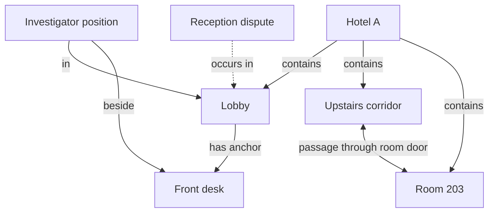
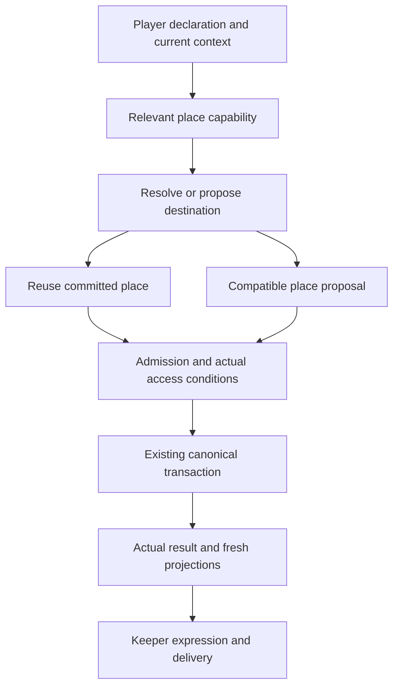

# Location system and demand-loaded place tool

Status: approved for specification, tickets, implementation and tests by the owner on 2026-10-19. The owner further requires an Enhanced Locations Mod, with supporting kernel changes allowed. The normative implementation contract is kernel RPC section 242; the execution ledger is [the ticket index](location-system-tickets/README.md). Research is not acceptance evidence.

Companion evidence: [Pro discussion and source observations](../research/location-tool-pro-discussion-20261019.md).

设计方向：把地点做成独立领域和精简的 `place` 入口，详细契约、布局资料与创作指导按需加载。地点、人物位置、前台等参照物、剧情场景分别保存；未登记触发查找或合理补全，不能直接判定无法进入。KP 负责理解和即兴，Jev 辅助有限选择，既有内核事务负责提交。重访读取同一个地点的当前状态，地点强化 Mod 拥有增强能力、版本与持久状态；关闭后仍可读取旧地点，兼容移动入口保留。

## 1. Intent and scope

The player chooses movement in natural language. Ordinary compatible destinations remain playable when the authored graph does not enumerate them. Previously established places, layouts and player consequences remain recognizable after returning or restarting. A quiet conversation should not carry the whole location authoring and movement schema.

The owner explicitly asked to evaluate a place tool separate from `apply`. The existing seven-verb surface is therefore a contract to revise deliberately, not a reason to reject the design. This document covers location identity, resolution, creation, movement, persistence, context loading and their necessary integrations. It does not redesign combat, money, the complete tool suite, the model hierarchy or the PDF pipeline.

Hollow completion would be renaming `apply move`, leaving all definitions in every request, allowing narration to move people without receipts, or registering enough scripted destinations to make a chosen example pass.

## 2. Observed starting point

- `kernel-ts/apply/move.ts` can establish a compatible new scene inline, but native packet movement in `runtime/turn-packet-prototype.ts` selects only an issued destination. The capabilities differ between entrances.
- `runtime/jev/scene-placement.ts` and `extensions/kernel/scene-placement.ts` place a destination after the Keeper has already proposed `move.establish`; they are not a universal natural-language destination resolver.
- `kernel-ts/read/table-entities.ts` persists table places, but identity is derived from the normalized name. It needs scoped identity to represent identically named rooms in different buildings.
- Missing `establish.within` defaults to the current scene. An uncertain semantic placement must not become a false containment fact through this default.
- `kernel-ts/read/places.ts` already reads authored containment. It also uses shared containment as a reachability ground; region membership, entrance access and journey time need distinct meanings.
- `kernel-ts/read/handlers.ts` currently reads the active scene for `look focus=scene`; a supplied remote `name` does not select a remote scene. The location read interface must state its target explicitly.
- Existing scene activity, NPC presence, objects, first sight and historical reference have their own owners. Location work should connect these readers and writers, rather than duplicate their state.

Tool-context observations:

- Current full `apply` source definition: 61,981 UTF-8 JSON bytes.
- Existing compact fixed-envelope projection: 5,860 bytes.
- The two full move variants total 6,008 bytes; scene activity contributes 1,383 bytes.
- These are source schema serializations, not provider-token or latency measurements.
- `extensions/table/context-runtime.ts#discoveryMode` returns `full` in the single-Keeper path. Selective capability/disclosure infrastructure exists, but it is not the default place-tool loading mechanism requested here.
- Current section 228 deliberately fixes the selective tool list and appends detail. Demand-loading a new typed tool is a proposed amendment to that policy, not a claim that the existing mode already implements it.

## 3. Separate the concepts

| Concept | Meaning | Example |
|---|---|---|
| Place | A persistent, re-identifiable location | Hotel A; its lobby; its room 203 |
| Anchor | A persistent spatial reference within a place | The front desk; a room door; a window |
| Spatial relation | Containment, connection or relative positioning | Room 203 belongs to Hotel A; its door opens onto a corridor |
| Scene | The current dramatic interaction or situation | Questioning a receptionist at midnight |
| Position | An actor's place and relevant within-place relation | In the lobby, beside the front desk |
| Place fact | A sourced, established or uncertain assertion | The room's window was broken during play |

Physical size and the words enter/leave do not determine scene promotion. A local position can carry meaningful cover, privacy or reach without automatically creating a full scene. A place can host different scenes over time. An authored narrative scene mentioning multiple places does not make those places the same physical location.

Looking at the front desk changes observation focus; walking beside it changes position. Refining an imprecise "inside the hotel" position to "in its lobby" does not by itself add travel time. Changing narrative focus must not move other actors.



This is a partial spatial model, not an exhaustive permitted-exit map. No fixed country/building/floor/room hierarchy is required. An arbitrary compatible place can start coarse and acquire the structure it actually needs.

Four independent dimensions replace a single registered/unregistered bit:

1. Identity and origin: authored place, table-created place, or unresolved reference.
2. Coverage: which parts have source evidence or established details, and which remain unspecified.
3. Residency: which material is in this request, available to read, or being prepared.
4. Access: actual entrances, barriers and consequences supported by current fiction.

Missing request material is not a fictional obstruction. An unresolved match is not proof that a place does not exist in the book.

## 4. Ownership

| Owner | Responsibility |
|---|---|
| Keeper | Interpret open player meaning, adjudicate compatibility, invent ordinary compatible detail, choose NPC reactions and describe actual outcomes |
| Jev | Closed matching/routing and relevance judgments over host-issued alternatives, with explicit no-match and uncertainty exits |
| Enhanced Locations Mod and its named kernel capability | Own versioned location policy, identities, relevant material, structure and the coherent place interface |
| Existing kernel transaction owner | Validate authority and versions, commit accepted facts/position/time, issue receipts and enforce idempotency |
| Mod package | Versioned manifest, capability requirement, state version, creation/continuity contract and demand-loaded sections |
| Historical Reference | Optional public era/place research in the existing Keeper inference; never permission or a new canonical-world writer |
| Final author/presentation | Render current public material and committed results, without inventing new arrivals or ownership changes |

The location module is deep when callers do not have to coordinate independent name lookup, duplicate detection, source readiness, parent inference and movement retry themselves. It may have internal seams, but exposes one coherent interface. The owner selects a real Mod boundary: the package is `enhanced-locations`, its named capability owns the enhanced behavior, and its durable state follows the existing Mod lock/migration lifecycle. Supporting kernel primitives do not create a competing spatial system. Existing saved identities remain readable when an enhancement is disabled.

## 5. Identity, facts and storage

Keep authored module data immutable. Enhanced records live in the existing versioned Mod state namespace and project into the effective graph; legacy table records remain readable. This is part of the same campaign world, not a second mutable world database. The concrete v1 wire and ownership are in kernel RPC section 242.

- The kernel mints stable identities. Display names and aliases are mutable, scoped references, not global identity hashes. Hotel A's room 203 and Hotel B's room 203 remain different.
- The Keeper uses supplied natural or qualified names and, where introduced by the contract, short host-issued references. It never invents opaque identifiers or copies hashes.
- Containment is explicit and cycle-checked. Departure location is route history, not an implicit parent. A genuinely unknown parent remains unknown until supported.
- Connections preserve directionality and actual conditions. A shared city or building does not grant universal access or zero travel time.
- Access conditions read their existing owners: a door's live state, a key's custody or an NPC's actual presence. A place description must not become a second lock, inventory or occupancy ledger.
- Reuse existing NPC and object identities and ledgers. A newly described chair can remain scenery until persistent interaction requires an object; registration is not automatic player possession.
- A small anchor record can preserve a named or interactive reference without creating a complete inventory object. Promotion to a richer object or place preserves its prior identity binding and facts.
- Each durable fact preserves its provenance and audience: source reference, table establishment, historical analogue, attributed report or unresolved possibility. A report that a hotel exists is not proof that its door is open.
- First registration is a representation event. It does not mean a building was just constructed or that its occupants arrived during this turn. Registration itself consumes no fictional travel time. Record a fictional creation event only when one actually occurred.
- Preserve changes and revision history. Revisiting reads the established place and its changes; it does not regenerate them from a seed, model call or refreshed source summary.
- Source enrichment may add supported missing material. It does not silently replace established identities, player consequences or source secrets.

Old records remain readable. An incremental migration can preserve legacy IDs and receipts while introducing new scoped identities and explicit bindings for future places. Use the existing campaign and worldline scope; do not introduce a separate cross-campaign place memory. A legacy record already conflating two places cannot be silently split by guessing from its name: retain the original evidence and resolve the consequential binding explicitly. Historical sessions and evidence are never rewritten.

## 6. Destination resolution

Read current input, recent public context and the small current-position projection. Search the union of relevant authored, previously established and currently referenced places. Candidate retrieval is a convenience for bounded reasoning, never the list of legal destinations.

Jev can distinguish known matches, local positioning, no match and uncertainty. A low score on a limited candidate set says nothing about the entire unread module. Open names, layouts and causal explanations remain the Keeper's work. Semantic destination and movement-intent judgments do not use keyword or regex classifiers.

Use these control outcomes internally:

- Current-place positioning: preserve the place identity and record a meaningful local position only when needed.
- Existing place: reuse identity and read required material.
- Source coverage gap: obtain targeted missing source material when its answer matters to the action.
- Compatible new place: the Keeper proposes sufficient facts for the chosen action; the kernel can establish it without requiring a full original-module reading.
- Genuine ambiguity: ask only when alternative interpretations materially change the player's commitment.
- Actual barrier or unresolved consequential condition: play that condition and preserve position until its outcome supports passage.

Ordinary compatible improvisation must not wait for an exhaustive negative proof over the book. Conversely, a weak candidate match must not replace the player's intended destination with the closest existing scene.

Coverage also describes relevant structural closure. An open street can gain a compatible entrance; a room already established as sealed cannot gain an exit just because no edge was indexed. Targeted source preparation should retrieve the necessary constraints, not turn every ordinary movement into a whole-module read.

The Keeper's spatial knowledge and the player's map knowledge remain distinct. A private source match may guide a compatible response, but discovery, navigation UI and public receipts must not enumerate undiscovered secret rooms merely because they exist in the graph.

## 7. External tool alternatives

The two-round discussion converges on a small resident `place` tool. Exact wire schemas still belong in the owning contract before implementation.

| Alternative | Benefit | Cost |
|---|---|---|
| Narrow projected `apply` | Small migration; existing batches remain intact | Keeper still coordinates multiple spatial protocols; a generic effect envelope hides the domain interface |
| Small resident `place`, with detailed context loaded by need | Clear spatial interface; ordinary creation and movement can share one call | Its basic schema still costs context; detailed material and history projection need explicit ownership |
| Several `place.*` functions in a discoverable family | Each operation has a small closed schema | Can create excess tool-choice and discovery round trips for ordinary movement |
| Completely hidden place capability | Minimum initial declaration size | Adds discovery work to frequent actions and makes routing misses more costly |

A separate tool is not a second transaction engine. A standalone `place` write submits a single-domain batch to the existing `apply` transaction path. A genuinely atomic mixed batch embeds the same location command beside other registered domain commands. Both entrances share one normalizer, validator and staging handler. Do not retain three divergent movement implementations.

Transport parity is essential: a native packet adapter cannot reimpose an issued-destination-only enum after the location module accepted an unresolved or inline-proposed destination. Qualified names, local references and compatible new places must reach the same resolver and transaction owner through every retained entrance.

The minimum logical interface has two request forms:

```text
place inspect
  target: optional semantic place reference
  need: context or contract
  question: optional focused question

place submit
  change: move or establish
  move: actors + target position + optional necessary route
  additions: optional typed places, anchors, passages and missing spatial details
```

`move` accepts both a destination place and a relevant local position. An unresolved semantic destination is retained as an unresolved request and yields specific binding/material needs; it is not rejected merely for lacking an issued ID. `establish` can record facts or elaborate existing unspecified space without moving anyone. A move can include its necessary additions, so creating a hotel, lobby, entrance and anchor does not require four construction calls followed by an arrival call.

Leaf shapes are closed by responsibility: a new place has a local name, explicit parent when known and necessary facts; an anchor has its owning place, name and relevant spatial description; a passage has endpoints and any actual boundary reference. Missing spatial details can be filled additively. Known facts cannot be overwritten through an elaboration request. References to actors bind real participants; a spatial draft creates neither NPCs nor possessions.

Use qualified semantic names or local names explicitly defined in this proposal. Kernel identity allocation and internal reference mapping remain host-owned. Do not make the model manufacture or repeat opaque global IDs.

Open descriptions, destination names, materials and relative positions are not an exhaustive building or position taxonomy. Command kinds and field responsibilities are closed; the fiction remains open. The Pro response's sample feature categories and relation enum are illustrative, not a new whitelist of all possible places or poses.

The basic creation shape stays small and resident. Full authoring instructions, unusual construction operations and source material load by need. This avoids making `establish` discovery mandatory for every ordinary new destination. One tool name by itself provides no size or latency guarantee.

Do not expose raw graph editing, arbitrary world patches or unrestricted event creation. Parent, destination and proposal references remain typed. Inline establishment should avoid a mandatory prepare/commit model round trip for ordinary new places when identity, authority and necessary facts are already clear.

## 8. Demand-loaded context

Always retain a small semantic core: current position, relevant consequential barriers, action authority rules, the minimal typed `place` declaration, one compact capability index and a read/discovery escape hatch. Detailed place contracts, extensive creation instructions and unrelated place records are not resident by default.

Discovery has two routes:

1. The host includes relevant place material and detailed guidance before the relevant inference when the current declaration, active task or grounded consequence requires it. The implementation uses one bounded Jev applicability batch per accepted input, asking actual movement, feature change and spatial lookup as independent propositions, memoized across provider calls. It selects context only; it never authorizes movement or invents a target. The active Mod's capability metadata enables this path. For a positively selected input, native publication reviews movement and persistent feature changes as separate axes before execution: the host reuses initial selection probabilities and accounts for actual operation classes in code. Existing mandatory admission alone judges their target and scope. Only a selected axis without an operation asks its independent obstacle Noul; actual intermediate movement is progress. Code retains the .4/.6 uncertainty gates. Time or registration alone cannot complete movement; position alone cannot complete a feature change. This completion check supplies no destination, world fact or action permission.
2. The Keeper can request place detail through the resident inspect path when a need appears during reasoning. The host retains the original intention and supplies the identified missing material in the next actual request. A missed selection returns actionable context, not a fictional refusal or an instruction to restate the same action. An unavailable selector leaves the canonical read/discovery path and Keeper reasoning available; it is not permission to guess a movement result.

"Place-related" includes asking about a destination, receiving directions, creating a persistent landmark, following a person and a supported forced displacement. It is not limited to the presence of a movement verb in the player's input, and it does not imply that a movement is authorized.

Implementation must distinguish:

- Registered executors: remain available to the canonical dispatcher.
- Declared model tools: the current request's selected typed interface.
- Guidance/detail: versioned content delivered when relevant.
- World material: relevant source and current state, not the whole registry.

Removing a declaration must not unregister the executor needed for host-owned movement. A hidden tool call cannot gain authority; execution still passes existing admission, validation and transaction owners. Do not use an open untyped envelope as the only way to make hidden operations callable.

A complete valid command is not refused merely because its long guidance was not previously disclosed. Load missing definitions or necessary world material when they are actually needed; do not add a "read the manual first" authorization gate. This preserves the useful part of section 228.3 while proposing a different disclosure policy.

Measure actual provider projection, including replayed tool checkpoints and appended detail. Merely removing a schema from the latest tools array may leave it elsewhere in model context. Preserve immutable raw history and supported provider transcript semantics. Providers that cannot portably remove a previously declared definition must report retained context honestly; cached or retained bytes are not zero bytes.

Project only host-owned, explicitly identifiable guidance blocks through the supported context hooks. Do not string-strip ordinary assistant text or reasoning to remove a remembered contract. [MiniMax's tool-use guide](https://platform.minimax.io/docs/guides/text-m3-function-call) requires complete assistant tool-continuation messages, including available reasoning fields. Old mixed history may need supported compaction or checkpoints; unavailable projection coverage is an explicit integration gap.

Prefer a stable small prefix and append newly disclosed detail at a stable history position. Exact provider-native deferred search is optional and capability-verified, not assumed for MiniMax, DeepSeek, Go or every Pi adapter. Use public host interfaces; no Pi fork or private runtime access is authorized by this design.

Keep tool identities stable. Quiet inputs receive the small `place` entry; a spatial input or actual place invocation receives the complete canonical declaration for that input. [MiniMax caching](https://platform.minimax.io/docs/api-reference/text-prompt-caching) includes tool declarations in prefix matching; [DeepSeek caching](https://api-docs.deepseek.com/guides/kv_cache/) also depends on matching prefixes. This explicit schema change may affect caching. Record declaration/history bytes, provider input and cache usage, model calls, first visible output and whole-turn latency separately. Preserve provider-specific counter semantics and mark absent counters unavailable. Source-byte reductions alone establish no token or speed improvement.

## 9. Commit, consequences and mixed actions

One writer owns committed location changes. The intended flow is:



An individual technical commit remains atomic. Prepare drafts without committing them; when the required facts are ready, dependent registration, position change and journey time can settle through one existing transaction. Retry reuses operation identity and actual outcomes rather than creating another hotel or charging time again.

The fictional journey can contain more than one actual milestone. Discovering a hotel and reaching its locked front door may establish the hotel, the door and the investigator's outside position; it does not establish entry into the lobby. An encounter at the staircase can stop an intended trip to a room after a valid earlier arrival. Preserve that completed progress and the remaining intention. A rejected technical batch publishes none of its dependent drafts, while separately committed earlier progress remains valid.

If new information invalidates a submitted interior-arrival plan, reject that batch atomically, refresh the relevant facts and submit the valid doorstep stage through the ordinary path. An exception handler must not retain half a move. A semantically revised batch follows existing new-call rules; it does not reuse the same idempotency key with different parameters. If commit status is unknown, query the existing result/receipt before asserting that nothing happened.

Do not make every composite player sentence a new global atomic transaction. Preserve existing atomic batches and meaningful fictional decision boundaries. An actual lock, NPC choice or skill result may need a preceding outcome. Paying for an agreed room and receiving its key can be one exchange, while walking upstairs can be a later stage if an intervening encounter matters.

For a genuinely indivisible cross-domain agreement, use this minimal bridge:

1. The Keeper supplies the same typed location change beside the existing registered cash/object commands in the existing batch entrance.
2. Host normalization and each domain's existing admission and validation prepare the batch without world writes.
3. The canonical transaction stages all accepted effects and commits them together, or commits none of that batch.
4. Its existing receipts, replay identity and result projections drive expression and recovery.

No location preparation ticket, new transaction store, parallel receipt protocol or mandatory preparation call is required. A standalone `place` submission is the same path with one domain's commands. Currency and custody fields do not enter the place schema. The relevant domain signatures can be disclosed for the rare mixed batch; every domain's long description need not become permanent tool context.

Later effects in a batch must read earlier staged effects where the existing transaction permits them: a room-entry check must see the key just received in that batch. Validate this seam through the production batch path. For an agreement requiring actual entry, reaching the doorstep is not an acceptable replacement success that allows the payment to commit. Several independent tool calls in one model response are not an atomic batch.

A successful move changes no unselected money, inventory, relationship or clue state. Ordinary route compression need not ask the player to traverse every intermediate named place, but it cannot skip a consequential obstacle or choose another commitment. Travel time is charged once under existing rules.

Failures identify the actual stage and concrete reason, plus what has or has not committed. Missing tool context is an internal recovery condition; a locked door is fictional state. Preserve each separately in telemetry and player-visible explanation where relevant.

## 10. Progressive place creation and the Enhanced Locations Mod

For a compatible ordinary hotel, first establish only the hotel, the actual arrival area and the facts needed now. Later questions or movement can add a restaurant, corridor or room while preserving everything already established.

The Mod supplies contextual authoring guidance: era and local setting, layout coherence, visible activity, meaningful interactions and access conditions. It does not require a fixed building-type dictionary, one mandatory floor plan per hotel, or a hidden plot hook in every room. Historical search can improve a specific missing detail through its existing foreground owner; no search availability or hit is required for ordinary compatible play.

The actual enhancement ships as a default-enabled, versioned Mod. Its state namespace owns enhanced places, anchors, passages and local position; the kernel supplies capability validation, graph projections and the existing transaction. The legacy movement adapter remains for compatibility. Disabling the enhancement refuses new enhanced writes explicitly and preserves readable established identities and facts; it does not delete a place or turn a disabled capability into a fictional wall. Ordinary minimal elaboration stays in the current Keeper inference. A separate tool-enabled materializer is an option for substantial requested authoring, not a mandatory agent chain for entering every new building.

An appearance in prose is not a substitute for necessary persistent state. The Keeper explicitly establishes consequential location facts before publication; the author expresses the accepted result. Optional decorative texture need not become a graph node. NPC/object/population work reuses its existing authoritative operations.

The first Pro response suggested allowing a fact-producing author where that product permits one; after receiving the actual expression boundary, its second response withdrew that suggestion. The Keeper prepares new anchors, names and actionable layout facts through the existing decision/commit path; expression receives those accepted facts. A bell can be a lightweight persistent anchor rather than a full enhanced item. Pure expression cannot announce a new actionable bell and retroactively settle its existence. Semantic omission remains a live continuity concern; a valid schema alone does not prove that all persistent prose references were recorded.

Adding a previously undefined appearance detail is different from opening or damaging an established window. The latter uses a legitimate world-change operation and its existing owner, not the additive fill path. Reusing an existing object binding when needed is sufficient for the first version; a general object-promotion framework is deferred. Disabling optional guidance preserves established place identities and facts. A missing specialized movement executor is reported as that actual capability gap.

## 11. Producer, reader and actor checks

| Material | Producer | Reader | Actor / resulting evidence |
|---|---|---|---|
| Stable place identity and relations | Kernel registration transaction | Effective graph, navigation and named-place reads | Keeper reuses the same destination; receipts reference that identity |
| Anchors and their richer-object bindings | Accepted Keeper additions and explicit promotion through the canonical transaction | Place context, named-reference resolution and the existing object owner when linked | Keeper resolves the same bell/window on a later action; necessary effects use that owner's receipts |
| Current position | Canonical movement/local-position owner | Capsule, NPC/object scopes, rules and author projection | Keeper acts from the actual place; narration follows settlement |
| Place creation draft | The same Keeper or explicitly scoped tool-enabled materializer | Structural and authority validation | Existing transaction accepts it; a draft alone changes nothing |
| Capability card and detail | Core tool registry and versioned Mod package | Discovery/loadout and Keeper request projection | Keeper uses the typed place tool; actual provider disclosure is recorded |
| Historical background | Existing granted search | Keeper's compatible elaboration | Newly established detail cites its evidence class; search itself commits nothing |

## 12. Incremental implementation and acceptance proposal

Implementation is now authorized and active; the ledger records actual code and acceptance. The following rollout outline is design context, superseded by section 242 and the filed EL tickets.

1. Amend the owning contract for the new tool surface, identity model, position distinction, loading/recovery policy and compatibility adapters, including the shared batch bridge in section 9.
2. Introduce the location module behind existing entrances and preserve old saves/receipts. Prove identity and state consistency through real production interfaces.
3. Expose the separate place tool and its demand-loading route. Retire divergent legacy movement schemas only after parity; the standalone tool and mixed batch keep their shared location-command contract.
4. Add the location Mod through the existing content/materialization lifecycle, with historical, NPC, object and first-sight integrations.
5. Perform actual provider-context measurements and genuine natural-language play, then separately package/accept only when authorized.

Required behavior cases:

- An unregistered ordinary hotel is enterable through compatible improvisation.
- A source-mentioned place absent from the current graph does not become a different invented destination.
- Moving beside a front desk preserves appropriate local position without forcing a new full scene.
- A locked room produces its actual barrier and supports a player-chosen alternative method.
- Two hotels can each have room 203; aliases, return visits and restart preserve the intended identity.
- Previously established objects, people and damage remain after departure and return.
- Asking directions or proposing a future visit performs no movement.
- Shared regional membership grants neither universal passage nor zero journey time.
- Unselected place detail can be obtained through the resident entry; unavailable/incorrect relevance selection does not create a fictional wall.
- An indivisible payment/key/entry batch sees staged custody, refuses all dependent effects together, and cannot substitute doorstep arrival for room entry.
- Mid-turn discovery, cancellation, retry, partial prior settlement and stale results preserve authority and idempotency.
- Narration, navigation, NPC/object scope and receipts agree on the destination.
- An unrelated conversation keeps only the basic declaration and omits detailed place guidance, unrelated layouts and authoring material from the actual model projection, including replay checkpoints. Context savings and cache effects are reported separately from latency.

Live acceptance follows the current project method and test-model policy. Natural play continues through meaningful situations; counts of scenes or turns do not substitute for coherent player experience. Pure tests and source measurements are labeled separately.

## 13. Review decisions and limits

Both GPT-6 Pro replies and exact prompts are retained in the [discussion record](../research/location-tool-pro-discussion-20261019.md) and its linked visible-response transcript. The first prompt supplied goals and failures without this proposed architecture; the second supplied the actual integration boundaries.

| Review point | Decision |
|---|---|
| Completely hide the whole location surface | Prefer a small resident `place` with basic creation shape; demand-load large guidance/material instead |
| Separate read/move/establish tools | Viable alternative, but a single query/submit interface shares the small contract and avoids mandatory creation discovery |
| Add location-owned preparation tickets or transactions | Reuse the same typed command in standalone and existing atomic batch entrances |
| Let pure expression create new facts | Declined; Pro withdrew the suggestion in round 2; keep pre-publication Keeper proposal and kernel commit |
| Lightweight stable features | Adopt anchors without mandatory inventory objects or a general upgrade framework |
| Optional authoring guidance alone as the Mod | Superseded by the owner's implementation clarification: the enhancement itself is a versioned Mod, with supporting kernel changes allowed |
| Pro's sample relation/category enums and opaque references | Treat sample values as illustrations; preserve open semantic descriptions and host-owned global identity |
| Every move runs Jev plus generator/reviewer agents | Decline; reuse the current Keeper inference, with extra work only for actual missing information |
| Removing current tools proves context savings | Decline; inspect actual request history, provider semantics, cache usage and latency |

The account's ChatGPT project supplied historical documents and its source panel also referenced the earlier excluded conversation through account memory. This was a neutral first prompt, not a demonstrably context-isolated blind review. No 5.6 answer was directly adopted. Current local source and verified primary documentation remain the evidence for implementation claims; Pro advice is a reviewed design contribution.

## 14. What game-engine practice contributes

These are architectural analogies, not claims that a videogame engine solves open-ended TRPG interpretation.

| Primary source | Useful separation | Adaptation and limit here |
|---|---|---|
| [CDPR: Building Night City](https://www.gdcvault.com/play/1028734/Building-Night-City-The-Technology), public GDC abstract | World-building hierarchy and runtime streaming belong to different systems | A hotel and its rooms keep identity independently of which material the Keeper has loaded. The public abstract does not establish a persistence algorithm. |
| [Unreal World Partition](https://dev.epicgames.com/documentation/en-us/unreal-engine/world-partition-in-unreal-engine) | World contents and loaded cells differ | Missing context cannot mean a nonexistent destination. Grid cells and physical asset streaming are unnecessary for a text TRPG. |
| [Unreal Smart Objects](https://dev.epicgames.com/documentation/en-us/unreal-engine/smart-objects-in-unreal-engine---overview) | Reusable definitions, instances and relative interaction slots differ | Standing beside a front desk need not replace the place. An interaction slot is an analogy, not a closed list of permitted player actions. |
| [Minecraft Jigsaw structures](https://learn.microsoft.com/en-us/minecraft/creator/documents/structures/introductiontojigsawstructures?view=minecraft-bedrock-stable) | Composite structures preserve attachment relationships | Validate a progressively added room's parent and connections. Do not require a finite hotel template pool or pre-enumerated exits. |
| [Ubisoft Census](https://news.ubisoft.com/en-ca/article/4po3S9Pwp1YcgBmGPmQxAh/watch-dogs-legion-the-tools-that-built-london) | Generation and persistent simulation have different jobs | Generation does not replace the record of what players changed. This application to places is an inference from an NPC system. |

The transferable design is persistent identity plus explicit relationships and selective material loading. Closed traversable maps, exhaustive prefabrication and asset-streaming machinery are not prerequisites for ordinary movement.

## 15. Worked hotel example

1. **"I enter a nearby ordinary hotel."** Interpret the actual declaration in context. Reuse a known hotel if that is what the player means. Otherwise establish a compatible hotel and arrival area with sufficient local facts; settle arrival once. If a real barrier matters, play that barrier. Missing registration alone creates none.
2. **"I walk beside the front desk."** Keep the lobby identity and record the relevant relation to the desk. Do not charge inter-place travel or create a dramatic scene solely because the player moved a few steps.
3. **"I go to my room."** Resolve the room assignment and access already established in play. Add a room or corridor only as needed. Having a room in a building's structure does not establish that this investigator owns a key.
4. **"I return to the lobby, then come back later."** Read the same room identity, occupants, objects and damage from committed state. Elaborate unspecified details without replacing the established ones. Another hotel's room with the same display name remains distinct.

If a corner later needs an independent persistent identity, promote the existing local reference and preserve its established relations and facts. Promotion is a representation change, not physical movement or permission to regenerate the corner.
## Owner-approved observation extension

The owner extended the work to a location association graph and repeated
observations of the same incident from different places, then requested a wiring
audit, canonical App rebuild/package and actual App testing. Contract section
243 owns the exact shape; this is Enhanced Locations 1.1.2, not a parallel
movement/event engine.

Existing place identity/containment remains the graph foundation. Typed directed
relations add potential sight/hearing between a place or feature and a target
place/feature. Passage, visibility and audibility are independent. Compatible
missing relations can be supplied inline during an actual observation, preserving
the open-world rule instead of introducing another preregistration gate.

Private preparation reads current target state and prior evidence without
performing perception. A selected `place observe` writes the actual scope,
perceived facts, existing people and any modest incident update through the
canonical transaction. Remote people remain at their actual target place.
Incident assessment time and player observation time are separate game-clock
values. Elapsed time requests a Keeper judgment, not forced change or a new
simulation lane. Existing current state wins over an old observation.

Every observation remains in the existing receipt/turn history. The Mod stores
only latest-settled observation indexes and current incident state. Previous
player knowledge is derived from actual current-line committed deliveries;
publication failure cannot silently advance that knowledge. Named target
features and explicit coverage prevent one street corner from refreshing the
whole street. Blocked views preserve the previous successful observation.

The seam audit follows writer, reader and actor: the shared transaction; focused
inspect and bounded current-viewpoint route projections; and actual Keeper use
followed by canonical outcome/frozen-result/sole-author consumption. Native
schemas enumerate all shared stationary place actions. The author receives
only committed public observation facts and identities, not the remote dossier,
and keeps observed people distinct from current-scene presence.

Acceptance requires deterministic boundary/transaction checks, real natural
play using the canonical driver and MiniMax M3.1/medium, then a stable-signed
canonical App build and real UI acceptance. A controlled argument fixture proves
the seam but cannot substitute for either live gate. Source and package results
remain separate, and failed evidence is preserved.

### Explicit waiting in observation acceptance (2026-10-19)

The packaged real-play wait asked for five minutes but the native packet offered
only a named time band. The Keeper selected momentary and the existing kernel
correctly charged that band's zero minutes. Do not change the band or rewrite
the settled observation. This is a native adapter gap against the existing
canonical TimeEffect.minutes path, not a new clock or location-time subsystem.

Native time commands accept exactly one of band or minutes. Minutes is a
nonnegative safe integer copied only from an explicitly selected player duration;
an unspecified cost still selects an issued band. The same restriction applies
to post-arrival activity. The compiler forwards that value to the existing time
effect, and the existing admission reviews its exact value before any clock
advance. The kernel still owns arithmetic, recovery, receipts and observed-clock
stamps. No language parser, keyword matching, new semantic lane, new gate or
changed confidence threshold is introduced. The fixed provider schema and current
schema tail both carry this grammar. Its mutual exclusion follows the official
[JSON Schema oneOf semantics](https://json-schema.org/understanding-json-schema/reference/combining#oneof).

Acceptance must prove a real explicit wait advances the canonical clock, then
the same remote person/incident can be observed at the later game minute. Pure
reference replies and repeated preparation reads still advance nothing.

Admission must see the same operation order as settlement. A selected wait or
arrival in the same proposed atomic batch is a possible prerequisite for a later
observation, conditional on that earlier operation's independent approval and
validation. A split review carries only its own operation and its ordered prefix;
reuse keys preserve the prefix order. Outside plans and future-only conditions
remain binding. No confidence threshold or permission boundary changes.

Focused inspection returns up to four actual delivered observation records for
the exact target/sense, with viewpoints, original clocks and canonical people.
The sole author receives only public delivered records actually read in this
input, grouped by at most two target/sense scopes; the context expires with the
input. This is reference knowledge, not another observation or NPC presence.
The existing answered location-context decision can prepare the sole route from
the current viewpoint for a reference need. Multiple routes retain explicit
inspection, and quiet or unavailable decisions do not prefetch history. Packing
uses the existing context budget. State/version migration and another semantic
classifier are unnecessary.
